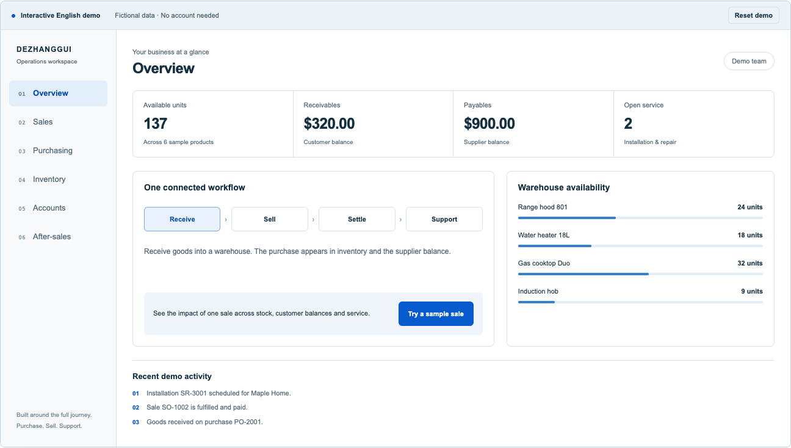

# Dezhanggui ERP · 德掌柜

**Sales, Inventory & After-sales Management**

Dezhanggui is a business management platform developed for DEAOE's home-appliance sales and after-sales operations. It connects the everyday work of buying stock, selling products, collecting payments and supporting customers.

[**Open the interactive English demo →**](https://XinYang0602.github.io/dezhanggui-erp-demo/)



## See what it does

| Workspace | What you can explore |
| --- | --- |
| Overview | Available stock, customer and supplier balances, open service requests and recent activity. |
| Sales | Create a sample sale and see inventory and receivables change. |
| Purchasing | Receive sample goods and see stock and payables increase. |
| Inventory | Search products and inspect sample warehouse availability. |
| Accounts | Settle a sample customer or supplier balance. |
| After-sales | Create and complete an installation or repair request. |

### Try a complete journey

1. Choose **Run a sample sale** and fulfil an order.
2. Open **Inventory** to inspect the available units.
3. Open **Accounts** and settle the new receivable.
4. Open **After-sales** and create a service request.
5. Complete the request, then return to **Overview** to see the updated activity.

All records and amounts are fictional. The simulation is deliberately simplified. Changes live only in the current page and reset on reload or with **Reset demo**. There is no connection to production systems.

## Why ERP?

ERP describes connected business operations. Dezhanggui focuses on purchasing, sales, inventory, settlement and after-sales workflows. SaaS describes a software delivery model; this showcase does not claim a public subscription offering, a full general ledger or payroll functionality.

## About this public repository

This repository contains only an independently authored English demonstration: static HTML, CSS, JavaScript, reviewed brand artwork and synthetic tests. It has its own history. The operational application, PHP backend, business rules, integrations and real records remain private.

The demo code is necessarily visible to browsers. It illustrates the product experience without exposing the production implementation.

## Run locally

Requires Python 3. No application server, account or database is needed.

```sh
python3 -m http.server 8000
```

Open `http://localhost:8000`. The same static files run on GitHub Pages.

## Updates

- **2026-11-18:** Launched the English interactive showcase with six workspaces and a sample purchase-to-service journey. Product source remains private.

See [CHANGELOG.md](CHANGELOG.md) for showcase changes.
